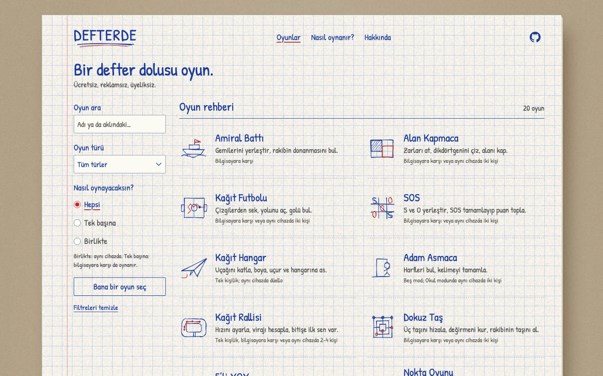
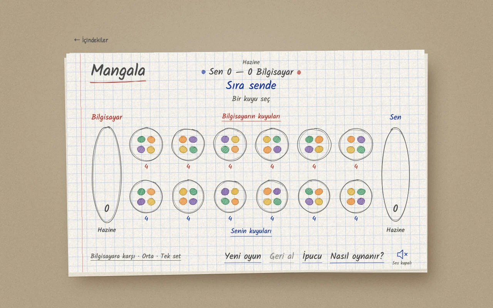
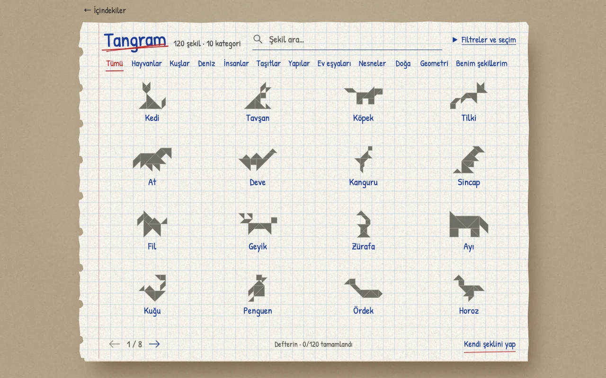
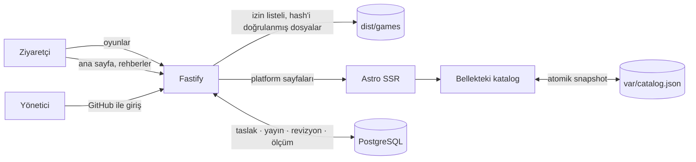

<div align="center">

# Defterde

**Bir defter dolusu oyun.**

Kareli defterin arka sayfasında oynadığımız oyunlar, tarayıcıda.<br>
Ücretsiz, reklamsız, üyeliksiz. Yirmi oyun, tek bir defter.

[**defterde.com**](https://defterde.com) · [Nasıl oynanır?](https://defterde.com/nasil-oynanir/) · [Katkı rehberi](CONTRIBUTING.md) · [Mimari](docs/MIMARI.md)

[](https://github.com/gorkemio/defterde/actions/workflows/ci.yml)
[](LICENSE)




</div>

## İçindekiler

- [Neden Defterde?](#neden-defterde)
- [Oyunlar](#oyunlar)
- [Nasıl çalışır?](#nasıl-çalışır)
- [Hızlı başlangıç](#hızlı-başlangıç)
- [Komutlar](#komutlar)
- [Ortam değişkenleri](#ortam-değişkenleri)
- [Testler](#testler)
- [Dağıtım](#dağıtım)
- [Proje yapısı](#proje-yapısı)
- [Katkıda bulunma](#katkıda-bulunma)
- [Lisans](#lisans)

## Neden Defterde?

Teneffüste, yolculukta, bir arkadaşını beklerken… SOS, Amiral Battı, Adam Asmaca, Nokta Oyunu: kâğıt kalemle oynanan oyunların yeri ayrı. Defterde o hissi tarayıcıya taşıyan küçük bir koleksiyon.

- **Reklam, üyelik, ücret yok.** Bir oyun seçmek yeterli.
- **Takip yok.** Çerez bandı yok, analitik betik yok. Platform yalnız oyun sayfası açılışlarının günlük toplamını tutar; kişi, oturum veya IP saklamaz. Ayrıntı: [gizlilik](https://defterde.com/gizlilik/).
- **Her oyun kendi defter sayfası.** Oyunlar bağımsız HTML belgeleridir; ortak motor veya SDK yoktur. Kayıtlar tarayıcının yerel deposunda kalır.
- **Hem tek başına hem birlikte.** Çoğu oyun bilgisayara karşı ya da aynı cihazı paylaşarak oynanır.
- **Erişilebilir ve hafif.** Ana sayfa JavaScript olmadan çalışır; büyük dokunma alanları, görünür klavye odağı, azaltılmış hareket desteği.
- **Dayanıklı.** Veritabanı çökse bile oyunlar ve son yayımlanan katalog açık kalır.

## Oyunlar

| Oyun                                                        | Tür                  | Ne yapıyorsun?                                                 | Kimle?                                                 |
| ----------------------------------------------------------- | -------------------- | -------------------------------------------------------------- | ------------------------------------------------------ |
| [Amiral Battı](https://defterde.com/oyunlar/amiralbatti/)   | Strateji             | Gemilerini yerleştir, rakibin donanmasını bul.                 | Bilgisayara karşı                                      |
| [Alan Kapmaca](https://defterde.com/oyunlar/alankapmaca/)   | Strateji             | Zarları at, dikdörtgenini çiz, alanı kap.                      | Bilgisayara karşı veya aynı cihazda iki kişi           |
| [Kağıt Futbolu](https://defterde.com/oyunlar/kagitfutbolu/) | Strateji             | Çizgilerden sek, yolunu aç, golü bul.                          | Bilgisayara karşı veya aynı cihazda iki kişi           |
| [SOS](https://defterde.com/oyunlar/sos/)                    | Strateji             | S ve O yerleştir, SOS tamamlayıp puan topla.                   | Bilgisayara karşı veya aynı cihazda iki kişi           |
| [Kağıt Hangar](https://defterde.com/oyunlar/kagithangar/)   | Yaratıcılık          | Uçağını katla, boya, uçur ve hangarına as.                     | Tek kişilik; aynı cihazda düello                       |
| [Adam Asmaca](https://defterde.com/oyunlar/adamasmaca/)     | Kelime               | Harfleri bul, kelimeyi tamamla.                                | Beş mod; Okul modunda aynı cihazda iki kişi            |
| [Kağıt Rallisi](https://defterde.com/oyunlar/kagitrallisi/) | Yarış                | Hızını ayarla, virajı hesapla, bitişe ilk sen var.             | Tek kişilik, bilgisayara karşı veya 2–4 kişi           |
| [Dokuz Taş](https://defterde.com/oyunlar/dokuztas/)         | Strateji             | Üç taşını hizala, değirmeni kur, rakibinin taşını al.          | Bilgisayara karşı veya aynı cihazda iki kişi           |
| [5'li XOX](https://defterde.com/oyunlar/xox/)               | Strateji             | X ve O'ları yerleştir, beşini aynı sırada buluştur.            | Bilgisayara karşı veya aynı cihazda iki kişi           |
| [Nokta Oyunu](https://defterde.com/oyunlar/noktaoyunu/)     | Strateji, bulmaca    | Noktaları birleştir, kutuları kapat, sayfayı renklendir.       | Bilgisayara karşı, iki kişi veya bulmaca               |
| [Sayı Bulma](https://defterde.com/oyunlar/sayibulma/)       | Bulmaca              | Artı ve eksi ipuçlarını izle, gizli sayıyı bul.                | Beş mod; bilgisayara karşı veya iki kişi               |
| [Türk Daması](https://defterde.com/oyunlar/turkdamasi/)     | Strateji             | Taşlarını ilerlet, rakibin taşlarını al, dama ol.              | Bilgisayara karşı veya aynı cihazda iki kişi           |
| [Kibrit Bulmacası](https://defterde.com/oyunlar/kibrit/)    | Bulmaca              | Kibrit çöplerini taşı, yanlış eşitliği doğru yap.              | Yedi mod; tek kişilik, bilgisayara karşı veya iki kişi |
| [Labirent](https://defterde.com/oyunlar/labirent/)          | Bulmaca              | Simli kalemle yolunu çiz, çıkışı bul.                          | Tek kişilik; hayalete veya kendi rekoruna karşı        |
| [Kakuro](https://defterde.com/oyunlar/kakuro/)              | Bulmaca              | Rakamları tekrarlamadan toplamları tamamla.                    | Tek kişilik; 60 bulmaca, üç zorluk                     |
| [Tangram](https://defterde.com/oyunlar/tangram/)            | Bulmaca, yaratıcılık | Yedi parçayla 120 şekli tamamla veya kendi şeklini tasarla.    | Tek kişilik                                            |
| [Domino](https://defterde.com/oyunlar/domino/)              | Strateji             | Eşleşen uçları birleştir, taşlarını önce sen bitir.            | Bilgisayara karşı veya aynı cihazda iki kişi           |
| [Mangala](https://defterde.com/oyunlar/mangala/)            | Strateji             | Taşları kuyulara dağıt, hazinende en çok taşı biriktir.        | Bilgisayara karşı veya aynı cihazda iki kişi           |
| [Kare Karalamaca](https://defterde.com/oyunlar/nonogram/)   | Bulmaca, yaratıcılık | Sayıların izinden kareleri karala, saklı resmi bul (nonogram). | Tek kişilik; 167 resim, günün karalaması               |
| [Beş Harf](https://defterde.com/oyunlar/besharf/)           | Kelime               | Her gün aynı beş harfli Türkçe kelimeyi altı tahminde bul.     | Günün kelimesi, serbest, iki kişi, düello              |

Her oyunun kısa kuralları sitede [Nasıl oynanır?](https://defterde.com/nasil-oynanir/) bölümünde, kodu ve kendi README'si `games/<oyun>/` altındadır.

<p align="center">
  
  
</p>

## Nasıl çalışır?

Defterde tek bir Node sürecidir: **Fastify** HTTP sunucusu, **Astro** ile sunucu tarafında üretilen platform sayfaları ve **PostgreSQL**'de tutulan yayın kataloğu.



- **Oyunlar statik dosyadır.** `config/games.json` her oyun için yayımlanacak dosyaları tek tek listeler. Build bu dosyaları `docs/imports/` altındaki SHA-256 kayıtlarıyla karşılaştırarak `dist/games/` altına paketler. Testler, araçlar ve belgeler web'den erişilemez. Ayrıntı: [oyun ekleme ve güncelleme](docs/OYUNLAR.md).
- **Katalog yönetimi.** `/yonetim/` yalnız sabit, sayısal GitHub kullanıcı ID'sine sahip hesaba açıktır (OAuth + PKCE). Başlık, açıklama, sıra ve görünürlük taslakta düzenlenir, önizlenir, yayımlanır; her yayın değişmez bir revizyondur ve geri alınabilir. Eşzamanlı düzenlemeler iyimser sürüm kontrolüyle çakışma verir.
- **Kesintiye dayanıklı.** Son yayın bellekte ve diskte (`var/catalog.json`) tutulur. Veritabanı erişilemezse oyunlar ve katalog açık kalır, yalnız yönetim kapanır.
- **Güvenlik.** Sıkı CSP, `__Host-` oturum çerezi, her yazmada Origin + CSRF denetimi, parametreli SQL, istek gövdesi sınırı, OAuth uçlarında oran sınırı. Ayrıntı: [mimari ve güvenlik](docs/MIMARI.md).

## Hızlı başlangıç

Gerekenler: **Node 24** ve npm. PostgreSQL isteğe bağlıdır.

```sh
git clone https://github.com/gorkemio/defterde.git
cd defterde
npm ci --ignore-scripts
npm run dev
```

`http://localhost:4321` açılır. Veritabanı olmadan bütün oyunlar ve başlangıç kataloğu çalışır; yönetim alanı kapalı kalır. `npm run dev` önce build alır, sonra sunucuyu başlatır; değişiklikten sonra yeniden çalıştır.

**Veritabanıyla** (yönetim alanı, ölçüm ve katalog revizyonları için):

```sh
docker run -d --name defterde-pg \
  -e POSTGRES_USER=defterde -e POSTGRES_PASSWORD=yerel \
  -p 127.0.0.1:5432:5432 postgres:17-alpine
cp .env.example .env   # DATABASE_URL içindeki CHANGE_ME yerine "yerel" yaz
npm run dev            # migration'lar açılışta otomatik uygulanır
```

Yönetim girişini yerelde denemek için `http://localhost:4321/auth/github/callback` callback adresli bir [GitHub OAuth App](https://github.com/settings/developers) oluşturup `GITHUB_CLIENT_ID`, `GITHUB_CLIENT_SECRET` ve kendi sayısal `GITHUB_OWNER_ID` değerini `.env`'ye yaz.

Tek bir oyunu platform olmadan açmak da mümkün: çoğu oyunda `games/<oyun>/index.html` dosyasını tarayıcıda açmak ya da o klasörde `npx serve .` çalıştırmak yeterli.

## Komutlar

| Komut                             | Ne yapar?                                                              |
| --------------------------------- | ---------------------------------------------------------------------- |
| `npm run dev`                     | Build alır ve `.env` ile sunucuyu başlatır                             |
| `npm run build`                   | Oyunları paketler, çizimleri üretir, Astro sitesini ve sunucuyu derler |
| `npm start`                       | Derlenmiş sunucuyu başlatır                                            |
| `npm run check`                   | Astro ve TypeScript tür denetimi                                       |
| `npm run format` / `format:check` | Prettier ile biçimlendirme / denetim                                   |
| `npm test`                        | Platform testleri (önce `npm run build` gerekir)                       |
| `npm run test:games`              | Her oyunun kendi birim testleri                                        |
| `npm run test:browser`            | Playwright testleri (Chromium, Firefox, WebKit)                        |
| `npm run games:verify`            | Oyun klasörlerinin kayıtlarla birebir aynı olduğunu doğrular           |
| `npm run games:record -- <oyun>`  | Bir oyundaki incelenmiş değişikliği kayda işler                        |
| `npm run db:migrate`              | Migration'ları elle uygular                                            |

## Ortam değişkenleri

`.env.example` dosyasını `.env` olarak kopyala. Hepsi isteğe bağlıdır; üretimde ilk beşi zorunludur.

| Değişken                                   | Varsayılan              | Açıklama                                                                  |
| ------------------------------------------ | ----------------------- | ------------------------------------------------------------------------- |
| `PUBLIC_ORIGIN`                            | `http://localhost:4321` | Sitenin kök adresi. Üretimde `https://` zorunlu.                          |
| `DATABASE_URL`                             | —                       | PostgreSQL bağlantısı. Yoksa site veritabanısız çalışır.                  |
| `GITHUB_CLIENT_ID`, `GITHUB_CLIENT_SECRET` | —                       | Yönetim girişi için GitHub OAuth App.                                     |
| `GITHUB_OWNER_ID`                          | —                       | Yönetime girebilecek tek hesabın **sayısal** GitHub ID'si.                |
| `HOST`, `PORT`                             | `127.0.0.1`, `4321`     | Dinlenen adres.                                                           |
| `SNAPSHOT_DIR`                             | `var`                   | Yayımlanmış katalog snapshot'ının klasörü.                                |
| `TRUST_PROXY`                              | kapalı                  | Ters vekil arkasında güvenilen hop sayısı (ör. `1`) veya IP/CIDR listesi. |
| `PUBLIC_REPO_URL`                          | bu depo                 | Sitenin sağ üst köşesindeki GitHub bağlantısı (build sırasında).          |

## Testler

```sh
npm run build && npm test     # platform testleri
npm run test:games            # oyun testleri
npm run games:verify          # oyun dosyası kayıtları
```

Veritabanı entegrasyon ve migration testleri `TEST_DATABASE_URL` (ve migration başına `TEST_<OYUN>_DATABASE_URL`) verilmezse açıkça atlanır. Adı `_test` ile biten ayrı veritabanları kullan; testler tabloları temizler. CI'da hepsinin nasıl kurulduğu [`.github/workflows/ci.yml`](.github/workflows/ci.yml) içinde.

Tarayıcı testleri çalışan bir sunucuya karşı koşar:

```sh
npx playwright install chromium firefox webkit
npm start &
npm run test:browser
```

Yönetim tarayıcı testi ayrıca bir test sunucusu (`ADMIN_BASE_URL`) ve test veritabanı ister; yoksa atlanır. Performans ölçümü: `node scripts/performance.mjs`.

## Dağıtım

Canlı site Docker Compose ile [Dokploy](https://dokploy.com) üzerinde çalışır: `deploy/compose.yml` web servisi ve iç ağdaki PostgreSQL'i tanımlar, migration'lar uygulama açılışında uygulanır.

```sh
docker build -t defterde:yerel .
```

Kurulum, secret'lar, yedekleme, geri yükleme ve oyun başına geri dönüş adımları: [docs/DAGITIM.md](docs/DAGITIM.md).

## Proje yapısı

```text
defterde/
├── games/<oyun>/        # 20 bağımsız oyun (HTML/CSS/JS, testler, lisanslar)
├── config/games.json    # katalog + yayımlanacak dosyaların izin listesi
├── docs/
│   ├── imports/         # oyun dosyalarının SHA-256 kayıtları
│   ├── MIMARI.md        # mimari, veri modeli, API ve güvenlik
│   ├── TASARIM.md       # görsel tasarım sözleşmesi
│   ├── OYUNLAR.md       # oyun ekleme ve güncelleme
│   └── DAGITIM.md       # dağıtım, yedekleme, geri dönüş
├── src/
│   ├── server/          # Fastify: API, GitHub girişi, statik sunum, migration
│   ├── pages/           # Astro sayfaları (ana sayfa, rehberler, yönetim)
│   ├── components/      # Sheet (defter sayfası), GameList
│   ├── lib/             # katalog modeli, keşif süzgeçleri
│   ├── client/          # ana sayfanın küçük istemci betiği
│   └── styles/
├── content/guides.json  # "Nasıl oynanır?" rehberleri
├── public/assets/       # font, çizimler, lisans künyeleri
├── scripts/             # paketleme, çizim üretimi, doğrulama araçları
├── deploy/              # compose, migration ve geri dönüş SQL'leri
└── tests/               # platform, migration ve Playwright testleri
```

## Katkıda bulunma

Hata bildirimleri, düzeltmeler ve öneriler memnuniyetle karşılanır. Başlamadan önce [katkı rehberine](CONTRIBUTING.md) göz at. Yeni oyun veya büyük değişiklikler için önce bir [issue](https://github.com/gorkemio/defterde/issues/new/choose) açman iyi olur. Güvenlik açıkları için [SECURITY.md](SECURITY.md).

## Lisans

Kod ve özgün çizimler [MIT](LICENSE) lisanslıdır. Yazı tipleri (SIL OFL 1.1), kütüphaneler (MIT), Tangram bulmaca verisi (GPL-2.0-or-later), kelime sıklığı verisi (CC BY-SA 4.0) ve TDK sözlük tanımları **kendi lisanslarıyla** dağıtılır; tam liste [UCUNCU-TARAF.md](UCUNCU-TARAF.md) dosyasında.

Teşekkürler: Patrick Wagesreiter (Patrick Hand), Preet Shihn (Rough.js), Innocent De Marchi (PECES), Hermit Dave (FrequencyWords), ogun/guncel-turkce-sozluk ve Türk Dil Kurumu, TÜDAF (Türk Daması kuralları) ve kâğıt kalem oyunlarını bize öğreten herkes.
